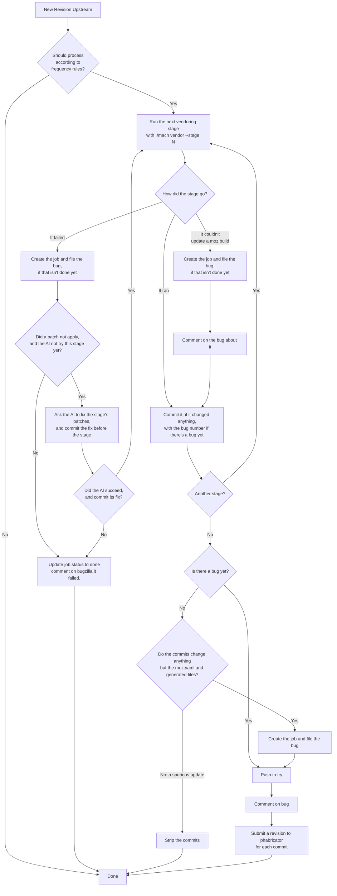

Creating the job and filing the bug also deals with any prior job's bug (duping it
to the new one, and abandoning its revisions), and gives the commits made so far
their messages, with the bug number.
